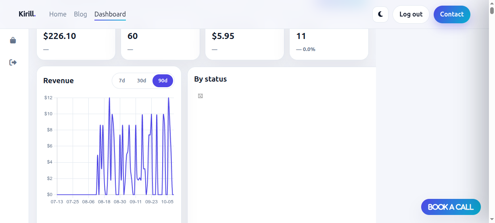

# Orders Admin Panel

A panel for small businesses that take orders in messengers (Telegram,
WhatsApp) and keep them in spreadsheets: one table with statuses, search
and filters, CSV export and sales statistics.

Single Flask app, SQLite, no build step. The demo data is a made-up home
bakery; amounts are in rubles.

---

## Screenshots

### Light theme (desktop view)


### Dark theme
The UI includes a full dark-mode palette (header toggle). Activate it
via the theme switch in the top bar on any page.

---

## Stack

| Layer | Choice | Why |
|-------|--------|-----|
| Web framework | **Flask 3** | Lightweight, standard WSGI, easy to test with the built-in client. |
| Database | **SQLite 3 + `sqlite3` stdlib** | No external service. File-based DB lives in `instance/app.db`. |
| Password hashing | `werkzeug.security` (ships with Flask) | `scrypt` / `pbkdf2` — no plaintext storage. |
| Frontend | **Vanilla JS** (no build step) | Keeps the repo runnable with two commands. |
| Charts | **Chart.js 4.4.1** (CDN) | Revenue line, status doughnut, top-products bars. |
| Icons | Font Awesome 6 (CDN) | UI icons + status chips. |
| Tests | `pytest` (dev dependency) | Routes, auth wall, validation, transitions, CSV & stats. |

No `package.json`, no bundler. Static assets are served from `css/`,
`js/`, `img/` via an explicit whitelist route.

---

## Quickstart (two commands)

```bash
pip install -r requirements.txt
python app.py
```

Then open **http://127.0.0.1:5000** in a browser.

On first boot the app:

1. Generates a random `SECRET_KEY` and stores it in `instance/secret_key` (mode 0600).
2. Creates `instance/app.db` and applies the idempotent schema (`PRAGMA foreign_keys=ON` + `journal_mode=WAL`).
3. Seeds ~60 deterministic demo orders (60-day window, random seed `42`)
   if the table is empty.

Stop the server with `Ctrl-C`.

---

## Environment variables

All configuration is read from the environment. Values in parentheses
are defaults.

| Variable | Purpose | Default behaviour |
|----------|---------|-------------------|
| `SECRET_KEY` | Flask session signing. Used for CSRF & session cookies. | Read from `instance/secret_key`; if missing, a 64-char token is generated and persisted there. |
| `ADMIN_USERNAME` | The single admin login. | `admin` |
| `ADMIN_PASSWORD` | The single admin password (plaintext input, hashed with werkzeug on boot). | `password123` |
| `FLASK_DEBUG` | If set to truthy enables `app.debug` and disables the `Secure` flag on the session cookie (useful for `http://` localhost). | `0` (off) → debug disabled; cookies are `Secure`, `HttpOnly`, `SameSite=Lax`. |
| `DATABASE_PATH` | Absolute or relative path to the SQLite DB file. | `instance/app.db` |

A `.env.example` file is included with every variable listed. The repo
is intentionally free of `python-dotenv` — export the variables in your
shell or process supervisor as usual.

---

## Demo credentials

Shown on the `/admin` login page (demo-only project):

| Username | Password |
|----------|----------|
| `admin`  | `password123` |

Click **Fill demo credentials** on the login screen to populate both
fields.

---

## REST API

JSON everywhere. Errors use a consistent shape:

| HTTP | Body | When |
|------|------|------|
| 401  | `{ "error": "unauthorized" }` | Missing session for any `/api/*` not in the allow-list. |
| 403  | `{ "error": "csrf" }`         | `POST`/`PATCH`/`DELETE` without `X-CSRF-Token` header. |
| 422  | `{ "errors": { "field": "msg" } }` | Validation failure on create / filter / status-change input. |
| 409  | `{ "error": "invalid_transition" }` | Disallowed order status transition. |
| 429  | `{ "error": "rate_limited", "retry_after_seconds": N }` | Too many failed logins from one IP. |

### Endpoints

| Method | Path | Purpose | Auth |
|--------|------|---------|------|
| `POST` | `/api/login` | Exchange `{username, password}` for a session cookie. Returns `{csrf_token}`. Allow-listed. | Public |
| `GET`  | `/api/me`    | Current session info `{authenticated, username?, csrf_token?}`. Allow-listed. | Public |
| `GET`  | `/api/orders` | Paginated, filterable order list. Query params below. | 🔒 |
| `POST` | `/api/orders` | Create a new order (status defaults to `pending`). Returns 201 + the new order. Writes an order event. | 🔒 |
| `GET`  | `/api/orders/<id>` | Single order plus its `events` timeline. | 🔒 |
| `PATCH`| `/api/orders/<id>/status` | `{ "status": "<next>" }`. Validates the transition rules, bumps `updated_at`, writes an event. Returns updated order. | 🔒 |
| `GET`  | `/api/orders/export.csv` | CSV download — same filters as `/api/orders`, no pagination. UTF-8 BOM + formula prefix escape (`'` prefix for cells starting with `= + - @ \\t \\n \\r`). | 🔒 |
| `GET`  | `/api/stats?days=7\|30\|90` | KPI cards + daily revenue series + by-status breakdown + top-5 products. | 🔒 |
| `GET`  | `/api/activity?limit=10` | Last N status-change events from `order_events` joined with orders. | 🔒 |
| `POST` | `/api/demo/reset` | Delete + re-seed the demo orders. Lets you restore the demo data on a public stand. | 🔒 |

### `/api/orders` filters (query string)

All optional.

| Param | Description | Default / limits |
|-------|-------------|------------------|
| `status` | Exact match on `pending` / `paid` / `shipped` / `completed` / `cancelled`. | all |
| `q`      | Searches `customer_name`, `customer_email`, `product`, or order id. Accepts `1042` and `#1042`. `%` and `_` are backslash-escaped for `LIKE`. | none |
| `date_from` / `date_to` | Inclusive `YYYY-MM-DD` filter on `created_at` (UTC). | full window |
| `min_amount` / `max_amount` | Decimal rubles on `amount_cents` (kopecks). E.g. `500` and `2000`. | full range |
| `sort` | Column from whitelist: `id`, `customer_name`, `product`, `amount_cents`, `status`, `created_at`. Any other value → 422. | `created_at` |
| `dir`  | `asc` or `desc` | `desc` |
| `page` | 1-based page number. | 1 |
| `per_page` | Rows per page. Max 100. | 10 |

Response:
```json
{ "items": [/* 10 orders */],
  "total": 47,
  "page": 1,
  "per_page": 10,
  "pages": 5 }
```

### `/api/stats` shape

```json
{ "period_days": 30,
  "kpi":      { "revenue_cents": 0, "orders": 0, "avg_order_cents": 0, "pending": 0 },
  "kpi_prev": { "revenue_cents": 0, "orders": 0, "avg_order_cents": 0, "pending": 0 },
  "series":   [{ "date": "YYYY-MM-DD", "revenue_cents": 0, "orders": 0 }],
  "by_status":      { "pending": 0, "paid": 0, "shipped": 0, "completed": 0, "cancelled": 0 },
  "top_products":   [{ "product": "", "revenue_cents": 0, "orders": 0 }] }
```

- `series` covers every day in the window — zero-filled for no-order days.
- `kpi_prev` mirrors `kpi` for the *previous* same-length window (for
  the KPI delta arrow on the dashboard).
- `by_status` counts **all** rows currently on each status (not
  period-scoped), matching the filter-chip counters on the page.
- `top_products` is capped at 5 rows, ordered by `revenue_cents` desc.

---

## Order status rules (FSM)

Amounts are stored in integer **kopecks** (RUB cents) and formatted on output
via `Intl.NumberFormat('ru-RU', {style:'currency', currency:'RUB'})`. Maximum order amount: 1,000,000.00.

| From status | Allowed next status(es) |
|-------------|-------------------------|
| `pending`   | `paid`, `cancelled`     |
| `paid`      | `shipped`, `cancelled`  |
| `shipped`   | `completed`             |
| `completed` | *(terminal, no change)* |
| `cancelled` | *(terminal, no change)* |

Disallowed transitions return HTTP 409. Every allowed transition
writes a row to `order_events` (`from_status`, `to_status`,
`created_at`) so the timeline drawer always shows the full history.

### Demo product catalogue

| Product                     | Price (RUB) |
|-----------------------------|-------------|
| Medovik cake, 1 kg          | 2,400 |
| New York cheesecake         | 3,200 |
| Croissant box (6 pcs)       | 1,150 |
| Eclairs (8 pcs)             | 1,440 |
| Cupcakes (12 pcs)           | 2,160 |
| Cherry pie                  | 1,100 |
| Weekly bread subscription   | 1,890 |
| Ginger cookie box           |   780 |
| Rosemary focaccia           |   390 |

----------------|-------------|
| Landing kit    | 4.90        |
| Telegram bot   | 3.20        |
| Dashboard      | 9.90        |
| Scraper        | 2.10        |
| Admin panel    | 7.40        |
| Web app       | 12.00       |
| Storefront     | 8.60        |
| Analytics      | 5.40        |
| Bot upgrade    | 1.80        |

---

## Definition of Revenue & KPI semantics

| KPI          | Meaning |
|--------------|---------|
| **Revenue**  | `SUM(amount_cents)` of orders where `status ∈ {paid, shipped, completed}` — i.e. money we can recognise. Cancelled and pending are excluded. |
| **Orders**   | Count of *all* orders created inside the period window, including cancelled and pending ones. |
| **Avg order value** | `revenue_cents / orders_in_period`, capped at `0` when denominator is 0. Currency = revenue denominator (recognised cents). |
| **Pending**  | Global CURRENT count of orders with status = `pending` (NOT filtered by period — matches the chip counter on the dashboard, same behaviour required by spec). |

---

## Project structure

```
.
├── app.py              # Flask app factory + routes (pages + orders API)
├── auth.py             # secret_key loader, admin creds (hashed), rate limit, CSRF helper
├── db.py               # SQLite connection, schema, deterministic 60-order demo seed
├── admin.html          # Login screen (/admin)
├── dashboard.html      # Protected panel: KPI cards, charts, table, modals
├── css/style.css       # Light + dark theme
├── js/                 # common.js (api, toast, theme), admin.js (login), dashboard.js
├── img/                # README screenshots
├── tests/              # pytest suite
├── instance/           # Runtime: secret_key and app.db (git-ignored)
├── .env.example        # Environment variable template
├── requirements.txt    # Runtime deps
└── requirements-dev.txt# pytest only
```

Routes served explicitly; everything else is a 404. The removed
catch-all and static `server.js` are absent from the repo, and the
auth-wall /static-deny tests assert that `/app.py`, `/app.db`,
`/instance/app.db`, `/../app.py` and `/requirements.txt`
all respond with HTTP 404.

---

## Running tests

Tests use an in-memory SQLite database, a fixed secret, and a
pre-computed password hash so the suite is deterministic.

```bash
pip install -r requirements-dev.txt
pytest tests/ -v
```

The suite covers:

- Auth-wall crawl of every `api/*` route except the 5-entry allow-list → 401. `/dashboard` → 302 to `/admin?next=`.
- Login: happy path, wrong password, sliding-window rate limit (5 fails / 1 min → 429, then resets).
- CSRF: any mutating request without `X-CSRF-Token` → 403.
- Order create: success case + each validation rule individually. Includes `0.1 + 0.2` float artifact (accepted) and `1e9` (rejected, exceeds the 1,000,000 cap).
- Status transitions: the full 5×5 matrix — every allowed pair returns 200 + an event row; every forbidden pair returns 409; terminal statuses cannot be edited; unknown status → 422.
- Filters & list: status, q, date_from/to, min/max amount, pagination, sort whitelist, `'; DROP TABLE orders;--` injection string (harmless), unknown `sort` → 422.
- CSV: UTF-8 BOM header, correct column headers, formula-cell escape (`'=SUM(1,2)` becomes `''=SUM(1,2)` in output row), filters are honoured, `Content-Disposition: attachment; filename="orders_YYYY-MM-DD.csv"`.
- Stats: hand-computed KPI/revenue assertions on a small fixture, zero-filled `series` for 7-day window, `kpi_prev` window offset is exactly the same length, by-status counts match.
- Static & deployment safety: code/db/source paths all return 404. Legacy `/dashboard.html` → 301 `/dashboard`.

---

## Security highlights

- Single admin user. Password is hashed with werkzeug at load time;
  never stored plaintext.
- `HttpOnly` + `SameSite=Lax` session cookie. `Secure` when `FLASK_DEBUG`
  is off (the default) so a deploy behind https:// gets the flag.
- Security headers on every response:
  `X-Content-Type-Options: nosniff`,
  `X-Frame-Options: DENY`,
  `Referrer-Policy: strict-origin-when-cross-origin`.
- `Cache-Control: no-store` for `/dashboard` and every `/api/*`
  response so no authenticated body lands in a shared or disk cache.
- Deny-by-default `before_request` guard for `/api/*`. Adding a new
  endpoint automatically requires a session unless you add the route
  to the public allow-list.
- CSRF tokens per session, checked on every `POST`/`PATCH`/`DELETE`.
  403 for missing or mismatched tokens.
- Route whitelist only: `/` (redirects to login or dashboard), `/admin`, `/dashboard`,
  `/css/*`, `/js/*`, `/img/*` — any other URL, including path-traversal
  attempts like `/../app.py`, returns a clean 404.
- DB access is parameterised queries only. Like-wildcards `%` and `_`
  in the search query are explicitly escaped before being passed to
  a `LIKE … ESCAPE '\'` clause.
- CSV formula-injection mitigation (apostrophe prefix).
- Frontend render helpers use `document.createTextNode` / `.textContent`
  — no `innerHTML` on user-supplied strings (try creating an order
  with customer name `` to verify).

---

## Optional: Deploy behind gunicorn

Because `create_app()` is a standard WSGI factory, the project works
directly under gunicorn / uwsgi without extra glue:

```bash
pip install gunicorn
gunicorn -w 2 -b 127.0.0.1:8000 'app:create_app()'
```

`SECRET_KEY`/`ADMIN_*`/`DATABASE_PATH` should be exported by your
supervisor (systemd, docker-compose env, etc.) rather than relying
on the on-boot file-based secret.
