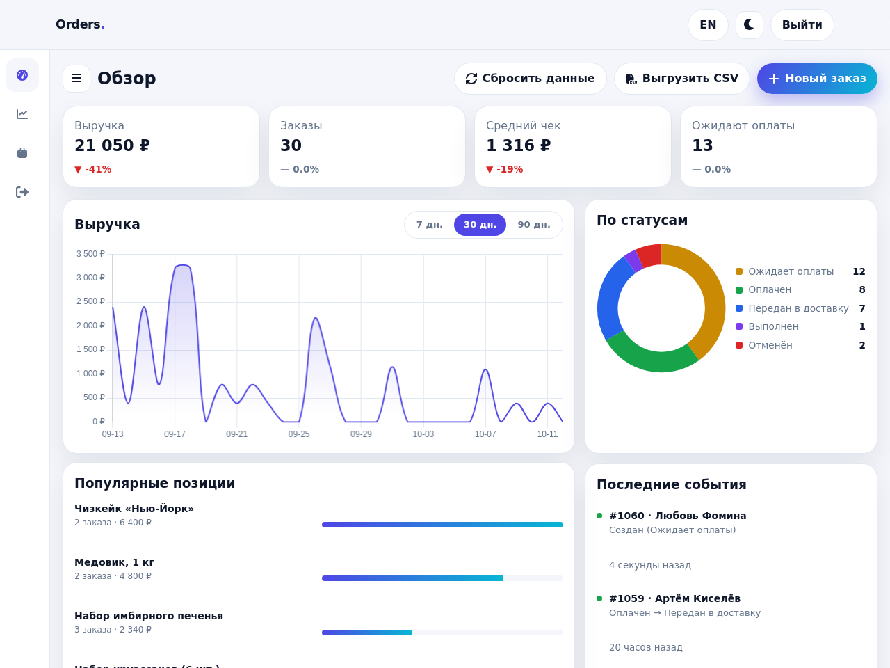
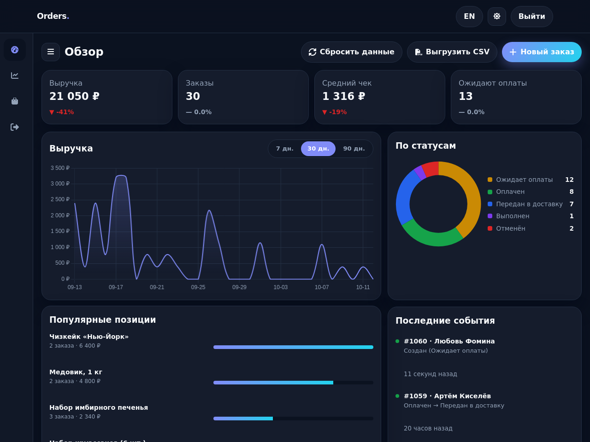

# Orders Admin Panel

[Русская версия (основная)](README.ru.md)

Order administration panel and backend for a Telegram bot. The stack uses Flask, SQLite, Gunicorn and vanilla JavaScript. Demo orders use a fictional bakery, «Хлебный день»; amounts are stored in kopecks.

## Features

- Manage orders, filter and search the table, export CSV and view sales statistics.
- Connect a Telegram bot through `/api/integrations/*` with a Bearer token.
- Use `DEMO_MODE` for public demo credentials and seeded orders. Set `DEMO_MODE=0` and an administrator password for production.
- Configure the session cookie with `COOKIE_SECURE` and trusted reverse proxy handling with `TRUST_PROXY`.
- Check `GET /healthz` without authentication or a database query.
- Enforce order status transitions with a finite-state machine and record changes in `order_events`.
- Manage products and prices, synchronize the bot catalogue and compare competitor prices.





## Quick start

```bash
pip install -r requirements.txt
DEMO_MODE=1 python app.py  # http://127.0.0.1:5000, admin / password123
```

`FLASK_DEBUG=1` enables Flask debug mode and disables the `Secure` cookie flag.

## Production

Install the dependencies, export the settings and start Gunicorn behind an HTTPS Nginx reverse proxy:

```bash
pip install -r requirements.txt
export DEMO_MODE=0 ADMIN_USERNAME=admin
export ADMIN_PASSWORD='<strong-password>' SECRET_KEY='<random-secret>'
export COOKIE_SECURE=1 TRUST_PROXY=1
# Set PANEL_API_KEY to a secret of at least 32 characters to enable bot integration.
export PANEL_API_KEY='<integration-token>'
gunicorn --workers 1 --threads 4 --bind 127.0.0.1:8000 'app:create_app()'
```

Configure Nginx to proxy requests to `127.0.0.1:8000`, terminate TLS and send `X-Forwarded-For`. Then check and reload its configuration:

```bash
sudo nginx -t && sudo systemctl reload nginx
```

Use one Gunicorn worker because login rate limits are stored in process memory. Enable `TRUST_PROXY=1` only behind a trusted proxy. The app does not load `.env` itself.

## Modes

| | `DEMO_MODE=1` (default) | `DEMO_MODE=0` |
|---|---|---|
| Credentials shown on the login page | yes | no |
| Demo orders seeded on first start | yes | no |
| `POST /api/demo/reset` | yes | 404 |
| Demo password `password123` | used | app refuses to start |

## Configuration

See [`.env.example`](.env.example): `SECRET_KEY`, `ADMIN_USERNAME`, `ADMIN_PASSWORD`, `DEMO_MODE`, `FLASK_DEBUG`, `DATABASE_PATH`, `TRUST_PROXY`, `COOKIE_SECURE`, `LOG_LEVEL`, `PANEL_API_KEY` (Telegram bot integration under `/api/integrations/*`; disabled with 404 when unset, min 32 chars), `BOT_CATALOG_PUSH_URL`, and `BOT_CATALOG_PUSH_TOKEN`. The app does not read `.env` itself; export the variables or pass the file to Docker.

## Order statuses

`pending` -> `paid` | `cancelled`; `paid` -> `shipped` | `cancelled`; `shipped` -> `completed`. Anything else returns 409 and every allowed change is logged in `order_events`. Amounts are stored in kopecks.

## API and security

Endpoint list, error formats, filters and the security notes (deny-by-default `/api/*`, CSRF, CSP, rate limit, HSTS) are described in [README.ru.md](README.ru.md). `GET /healthz` returns `{"status": "ok"}`.

### Bot integration (`/api/integrations/*`)

Requires `PANEL_API_KEY` (≥ 32 chars) and `Authorization: Bearer <key>` header.

| Method | Path | Description |
|--------|------|-------------|
| `GET` | `/api/integrations/catalog` | Active own products with `id`, `name`, `price_cents` (bare array; legacy contract) |
| `GET` | `/api/integrations/catalog-versioned` | Atomic versioned catalogue: `{"catalog":[{"id","name","price_cents"}],"version":N}` |
| `GET` | `/api/integrations/competitor-prices` | Competitor snapshot for the bot's price monitor (bare array; stable `competitor_id`/`product_id`, `competitor_name`, `product_name`, `price_cents`, nullable `own_price_cents`) |
| `POST` | `/api/integrations/orders` | Create order from Telegram bot |
| `PATCH` | `/api/integrations/orders/<id>/status` | Change order status (body `{"status": "paid"}`; 404 unknown order, 409 invalid transition, 422 invalid status) |
| `GET` | `/api/integrations/events` | Order status events for Telegram orders (`?since_id=N&limit=50`, max 200; fields `id`, `order_id`, `status`, `created_at`; cursor by event id) |
| `POST` | `/api/integrations/forget` | Anonymize a Telegram user's orders (body `{telegram_user_id}`; name → «Удалено», phone and username cleared; idempotent, always 200) |

`POST /api/integrations/orders` body:
```json
{
  "customer_name": "Анна",
  "telegram_user_id": 123456,
  "telegram_username": "anna_s",
  "customer_phone": "+79991234567",
  "delivery_date": "2026-11-01",
  "note": "Without nuts",
  "items": [{"product_id": 1, "quantity": 2}]
}
```
Requires `Idempotency-Key` header (UUID). Prices are computed from the catalogue — the bot only sends `product_id` and `quantity`. Returns 201 on creation, 200 on duplicate key, 422 on validation error.

## Own assortment and bot prices

The panel manages the bot's prices. The bot can bootstrap with the versioned
`GET /api/integrations/catalog-versioned` response; the old `GET /api/integrations/catalog` bare-array contract remains available. Set both `BOT_CATALOG_PUSH_URL` (for example
`http://bot:8080/catalog`) and `BOT_CATALOG_PUSH_TOKEN` to enable panel-to-bot delivery.
Every actual product create, rename, price, or visibility change atomically stores an
immutable snapshot in SQLite and POSTs it to that URL as
`{"catalog":[{"id":1,"name":"...","price_cents":240000}],"version":N}` with
`Authorization: Bearer <BOT_CATALOG_PUSH_TOKEN>` and `Content-Type: application/json`.
Versions are globally monotonic and start at 1. The receiver must atomically apply a
strictly newer version and return any 2xx response; equal/older versions must be
idempotently ignored. Delivery is FIFO, uses exponential retry (up to five minutes),
and survives panel restarts. A configured panel also queues a fresh snapshot at startup,
so a bot that was unavailable while the panel was down catches up without an edit.
The offline menu contains the same 20 demo products. Price changes are stored in
`my_price_history` for auditing.

“My products” lets an administrator add products, edit names/prices, hide and
reactivate products. “Change” in the competitor comparison edits the mapped
**own** product, never the competitor's price. Mapping references a product ID,
so comparisons always display the current own price.

Session-protected management API (writes also require CSRF):

- `GET /api/products` — all products, including inactive ones (`{"items":[...]}`).
- `POST /api/products` — `{"name":"Булочка с корицей","price_cents":18000}`.
- `PATCH /api/products/<id>` — `name`, `price_cents` and/or boolean `is_active`.
- `GET /api/products/history` — latest 100 price changes.

The integration catalog retains its Bearer-protected **bare JSON array** format
with `id`, `name`, `price_cents`, but reads only active database products.
Order creation uses current database prices; existing orders keep their snapshots.
The bread subscription (legacy ID 7) is inactive; other IDs remain stable.
Demo reset affects orders, not managed prices or price history.

## Tests

```bash
pip install -r requirements-dev.txt
ruff check . && pytest -q
```

## Third-party files

Chart.js 4.5.1 (MIT) in `js/vendor`; Font Awesome Free 7.3.1 icons (CC BY 4.0) as a generated `css/vendor/fa-icons.css` (see `scripts/build_icons.py`). No external requests at runtime.

## License

MIT, see [LICENSE](LICENSE).

## Automatic refresh

The dashboard polls every 5 seconds after the previous refresh completes. Orders,
summary, status counts and activity update without reloading the page or resetting
filters and pagination. Background refresh retains the existing table on errors
and pauses while the tab is hidden, a modal/drawer/status menu is open, or an input
is focused. Returning to the tab triggers an immediate refresh.

Polling regression tests (Node.js, no additional packages):

```bash
node --test tests/auto_refresh.test.cjs
```
