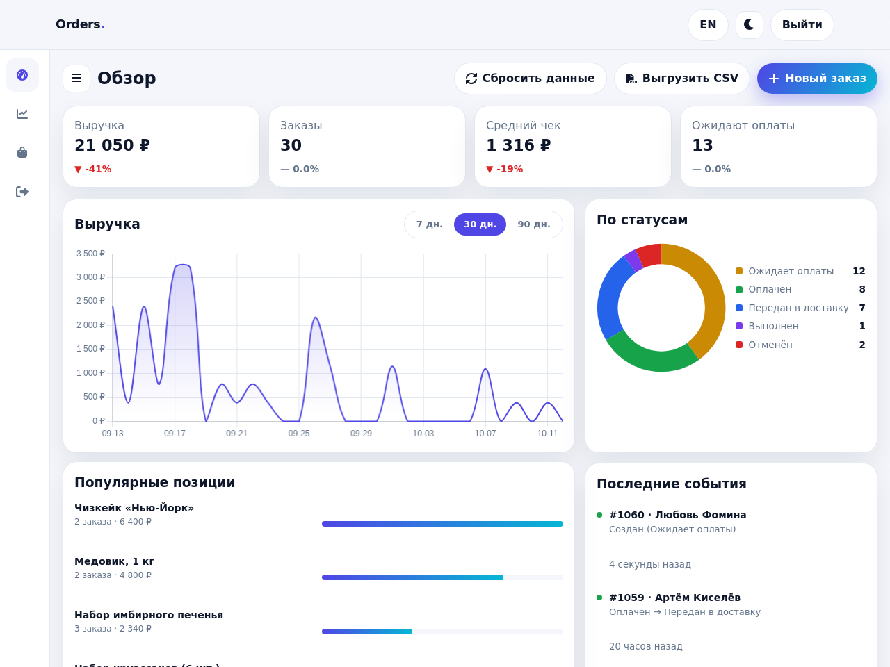
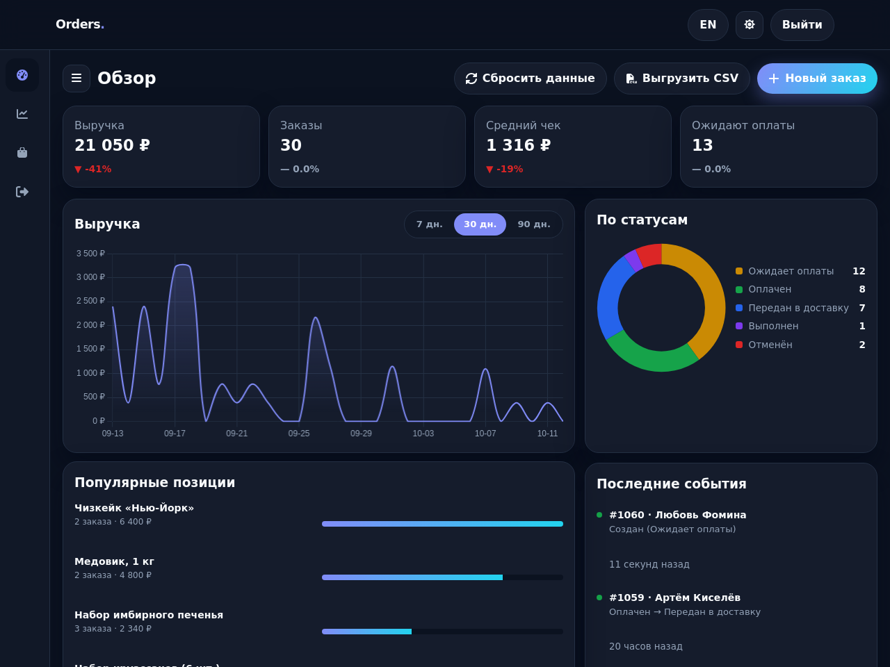
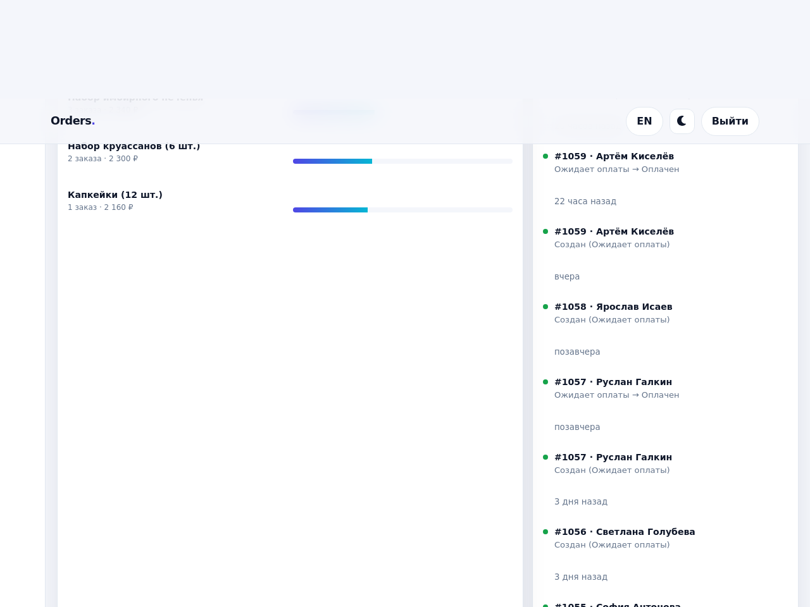

# Админ-панель заказов

[English version](README.md)

Панель для небольшого бизнеса, который принимает заказы в мессенджерах и ведёт их в таблицах: одна таблица со статусами, поиск и фильтры, выгрузка в CSV, статистика продаж.

Одно приложение на Flask, SQLite, без сборщика. Демо-данные относятся к вымышленной пекарне «Хлебный день», суммы в рублях.







Мобильный вид: [img/mobile-light.png](img/mobile-light.png). Снимки делает `python scripts/screenshots.py`.

Переключатели темы (светлая и тёмная) и языка (RU/EN) находятся в верхней панели. Язык по умолчанию русский, выбор сохраняется в браузере.

## Быстрый старт

Демо-режим, в Python:

```bash
pip install -r requirements.txt
DEMO_MODE=1 FLASK_DEBUG=1 python app.py
```

Откройте http://127.0.0.1:5000. Логин и пароль показаны на странице входа (`admin` / `Ltso2uJVANwzxlpwp-f6PvLB`). `FLASK_DEBUG=1` нужен только для работы по `http://` на своей машине: он отключает флаг `Secure` у cookie сессии.

Демо-режим, в Docker:

```bash
docker compose up --build
```

Откройте http://localhost:5000. Том `panel-data` хранит базу и ключ сессий.

При первом запуске приложение создаёт `instance/app.db`, применяет схему и, **только в демо-режиме**, добавляет 60 демо-заказов за 60 дней. Секретный ключ сессий берётся из `SECRET_KEY` или создаётся в `instance/secret_key`.

## Режимы работы

| | `DEMO_MODE=1` (по умолчанию) | `DEMO_MODE=0` |
|---|---|---|
| Логин и пароль на странице входа | показаны | скрыты |
| Демо-заказы при первом запуске | создаются | нет |
| `POST /api/demo/reset` и кнопка «Сбросить данные» | есть | нет (404) |
| Пароль по умолчанию `Ltso2uJVANwzxlpwp-f6PvLB` | допустим | приложение не стартует, в консоль выводится причина |

Для публичного демо используйте `DEMO_MODE=1`, для реальной работы `DEMO_MODE=0` и свой `ADMIN_PASSWORD`.

## Переменные окружения

Шаблон лежит в [`.env.example`](.env.example). Панель сама `.env` не читает: экспортируйте переменные в оболочке или передайте файл в Docker (`docker compose --env-file .env up`).

| Переменная | Назначение | По умолчанию |
|---|---|---|
| `SECRET_KEY` | Подпись сессий и CSRF-токенов | создаётся и сохраняется в `instance/secret_key` |
| `ADMIN_USERNAME` | Логин администратора | `admin` |
| `ADMIN_PASSWORD` | Пароль администратора (при запуске хешируется) | `Ltso2uJVANwzxlpwp-f6PvLB`; при `DEMO_MODE=0` обязателен и не может быть таким |
| `DEMO_MODE` | Демо-режим, см. таблицу выше | `1` |
| `FLASK_DEBUG` | Режим отладки, отключает `Secure` у cookie и HSTS | `0` |
| `DATABASE_PATH` | Путь к файлу SQLite (относительный считается от папки проекта) | `instance/app.db` |
| `TRUST_PROXY` | `1`: панель за реверс-прокси, IP клиента берётся из `X-Forwarded-For` (для ограничения попыток входа) | `0` |
| `COOKIE_SECURE` | `0`: не ставить `Secure` на cookie сессии (только для `http://localhost`) | `1` |
| `LOG_LEVEL` | Уровень логов | `INFO` |
| `PANEL_API_KEY` | Ключ API интеграции (Bearer) | не задан |
| `BOT_CATALOG_PUSH_URL` | Полный HTTP(S)-адрес bot endpoint, например `http://bot:8080/catalog` | не задан |
| `BOT_CATALOG_PUSH_TOKEN` | Bearer-токен panel → bot push | не задан |

`PANEL_API_KEY` включает интеграцию с Telegram-ботом (`/api/integrations/*`, заголовок `Authorization: Bearer`). Не задан: эндпоинты отвечают 404. Короче 32 символов: панель не стартует.

| Метод | Путь | Описание |
|-------|------|----------|
| `GET` | `/api/integrations/catalog` | Каталог товаров: `id`, `name`, `price_cents` (старый bare-array контракт) |
| `GET` | `/api/integrations/catalog-versioned` | Атомарный снимок `{ "catalog": [{"id","name","price_cents"}], "version": N }` |
| `POST` | `/api/integrations/orders` | Создание заказа ботом (обязателен `Idempotency-Key`; цены считает панель) |
| `PATCH` | `/api/integrations/orders/<id>/status` | Смена статуса (тело `{"status": "paid"}`; правила переходов как в панели; 404 — заказ не найден, 409 — недопустимый переход, 422 — неверный статус) |
| `GET` | `/api/integrations/events` | События статусов заказов из Telegram (`?since_id=N&limit=50`, максимум 200; поля `id`, `order_id`, `status`, `created_at`; курсор по id события) |
| `POST` | `/api/integrations/forget` | Анонимизация заказов пользователя Telegram (тело `{telegram_user_id}`; имя → «Удалено», телефон и username очищаются; идемпотентно, всегда 200) |

`BOT_CATALOG_PUSH_URL` и `BOT_CATALOG_PUSH_TOKEN` задаются только вместе. При их наличии панель отправляет `POST` JSON `{ "catalog": [...], "version": N }` на URL с `Authorization: Bearer <BOT_CATALOG_PUSH_TOKEN>` и `Content-Type: application/json`. Версии начинаются с 1 и монотонно возрастают. Каталог и версия одного push, как и ответ `GET /api/integrations/catalog-versioned`, читаются из одного SQLite-снимка. Бот должен атомарно применить только строго новую версию, игнорируя равные и меньшие, и вернуть любой 2xx.

Снимки хранятся в SQLite outbox до успешного ответа, доставляются строго по порядку версий и повторяются с экспоненциальной задержкой до 5 минут. При запуске настроенной панели добавляется актуальный снимок: бот, недоступный во время остановки панели, получает каталог без нового изменения товара.

## Статусы заказов

Суммы хранятся в копейках (целые числа) и показываются в рублях. Максимальная сумма заказа: 1 000 000,00.

| Из статуса | Можно перевести в |
|---|---|
| `pending` (ожидает оплаты) | `paid`, `cancelled` |
| `paid` (оплачен) | `shipped`, `cancelled` |
| `shipped` (передан в доставку) | `completed` |
| `completed`, `cancelled` | конечные, менять нельзя |

Недопустимый переход возвращает 409. Каждый допустимый переход пишется в `order_events`, поэтому в карточке заказа видна вся история.

### Демо-каталог

| Позиция | Цена, ₽ |
|---|---|
| Медовик, 1 кг | 2 400 |
| Чизкейк «Нью-Йорк» | 3 200 |
| Набор круассанов (6 шт.) | 1 150 |
| Эклеры (8 шт.) | 1 440 |
| Капкейки (12 шт.) | 2 160 |
| Вишнёвый пирог | 1 100 |
| Набор имбирного печенья | 780 |
| Фокачча с розмарином | 390 |
| Ржаной хлеб на закваске | 140 |
| Пшеничный батон | 90 |
| Багет | 110 |
| Чиабатта | 130 |
| Бородинский хлеб | 125 |
| Круассан с маслом | 200 |
| Булочка с корицей | 140 |
| Пирожок с яблоком | 80 |
| Ватрушка с творогом | 105 |
| Синнабон со сливочным кремом | 240 |
| Слойка с сыром | 160 |
| Печенье с шоколадом (3 шт.) | 210 |

Общее меню с `khlebny-den-bot`: 20 активных позиций. ID 7 (подписка) не используется.
Миграция v4 добавляет недостающие товары, сохраняя цены, видимость и ID существующих.


## API

Все ответы в JSON. Ошибки:

| Код | Тело | Когда |
|---|---|---|
| 401 | `{"error": "unauthorized"}` | нет сессии у любого `/api/*`, кроме `POST /api/login` и `GET /api/me` |
| 403 | `{"error": "csrf"}` | `POST`/`PATCH`/`DELETE` без верного `X-CSRF-Token` |
| 422 | `{"error": "validation_failed", "errors": {"поле": "сообщение"}}` | ошибка в данных |
| 409 | `{"error": "invalid_transition"}` | недопустимая смена статуса |
| 429 | `{"error": "too_many_attempts", "retry_after_seconds": N}` | больше 5 неудачных входов за минуту с одного IP |

| Метод | Путь | Назначение |
|---|---|---|
| `GET` | `/healthz` | `{"status": "ok"}`, без авторизации и без обращения к базе |
| `POST` | `/api/login` | `{username, password}` -> сессия и `csrf_token` |
| `GET` | `/api/me` | состояние сессии |
| `POST` | `/api/logout` | выход |
| `GET` | `/api/orders` | список с фильтрами и пагинацией |
| `POST` | `/api/orders` | создать заказ (статус `pending`) |
| `GET` | `/api/orders/<id>` | заказ с историей статусов |
| `PATCH` | `/api/orders/<id>/status` | `{"status": "..."}`, проверка правил переходов |
| `GET` | `/api/orders/export.csv` | CSV с теми же фильтрами; ячейки, начинающиеся с `= + - @`, экранируются; телефон `+7XXXXXXXXXX` выводится как `+7 (XXX) XXX XX-XX` |
| `GET` | `/api/stats?days=7\|30\|90` | показатели, выручка по дням, разбивка по статусам, топ-5 позиций |
| `GET` | `/api/activity?limit=10` | последние смены статусов |
| `POST` | `/api/demo/reset` | пересоздать демо-данные (только `DEMO_MODE=1`) |

Фильтры `/api/orders` (все необязательные): `status`, `q` (имя, e-mail, позиция или номер заказа, можно `#1042`), `date_from`, `date_to` (`YYYY-MM-DD`), `min_amount`, `max_amount` (в рублях), `sort` (`id`, `customer_name`, `product`, `amount_cents`, `status`, `created_at`), `dir` (`asc`/`desc`), `page`, `per_page` (до 100, по умолчанию 10).

Выручка в статистике считается по заказам со статусами `paid`, `shipped`, `completed`. «Ожидают» — текущее число заказов в `pending` независимо от периода.

## Безопасность

- Одна учётная запись, пароль хранится только в виде хеша.
- Cookie сессии: `HttpOnly`, `SameSite=Lax`, `Secure` (если не `FLASK_DEBUG` и не `COOKIE_SECURE=0`).
- Любой `/api/*` без сессии закрыт, исключения перечислены явно. Новый эндпоинт по умолчанию требует вход.
- CSRF-токен на каждый `POST`/`PATCH`/`DELETE`.
- Заголовки: `Content-Security-Policy`, `X-Content-Type-Options`, `X-Frame-Options: DENY`, `Referrer-Policy`, `Strict-Transport-Security` (вне режима отладки), `Cache-Control: no-store` для `/dashboard`, `/api/*` и `/healthz`.
- Никаких внешних запросов: Chart.js и иконки лежат в репозитории (`js/vendor`, `css/vendor`), политика CSP разрешает только свой origin.
- Ограничение попыток входа хранится в памяти процесса, поэтому Docker-образ запускает один процесс gunicorn (с потоками). За реверс-прокси включите `TRUST_PROXY=1`.
- Статика отдаётся только из `css/`, `js/`, `img/`; всё остальное, включая попытки выйти из папки, возвращает 404.
- Запросы к базе параметризованы. Данные пользователя выводятся через `textContent`, не через `innerHTML`.

## Структура

```
app.py               Flask-приложение и маршруты
auth.py              ключ сессий, пароль, ограничение попыток, CSRF
db.py                SQLite, схема, демо-данные
admin.html           страница входа
dashboard.html       панель: показатели, графики, таблица
css/ js/ img/        статика (css/vendor, js/vendor: сторонние файлы)
scripts/             build_icons.py: сборка css/vendor/fa-icons.css из SVG
tests/               тесты pytest
Dockerfile, docker-compose.yml
.env.example
```

## Тесты

```bash
pip install -r requirements-dev.txt
ruff check .
pytest -q
```

Тесты идут на базе в памяти, с фиксированным ключом и готовым хешем пароля. Покрыто: закрытые маршруты, вход и ограничение попыток, CSRF, создание и валидация заказов, полная матрица переходов статусов, фильтры и сортировка, CSV, статистика, демо-режим и режим без демо, `/healthz`, CSP, раздача статики.

## Деплой за gunicorn

```bash
gunicorn --workers 1 --threads 4 --bind 127.0.0.1:8000 'app:create_app()'
```

Один рабочий процесс нужен из-за ограничения попыток входа в памяти. Переменные (`SECRET_KEY`, `ADMIN_PASSWORD`, `DEMO_MODE=0`, `TRUST_PROXY=1`) задайте через systemd или compose. TLS обеспечивает реверс-прокси.

## Сторонние файлы

- [Chart.js](https://www.chartjs.org) 4.5.1, лицензия MIT (`js/vendor/chart.umd.min.js`, текст лицензии в `js/vendor/chart.js.LICENSE.md`).
- Иконки [Font Awesome Free](https://fontawesome.com) 7.3.1, лицензия CC BY 4.0 (`css/vendor/fa-icons.css`, текст лицензии в `css/vendor/fontawesome.LICENSE.txt`). Из набора взяты только используемые иконки стиля solid, CSS собирается командой `python scripts/build_icons.py --svg-dir <папка svgs/solid>`.

## Лицензия

MIT, см. [LICENSE](LICENSE). Сторонние файлы распространяются на своих условиях (см. выше).


## Цены конкурента

Раздел «Конкуренты» доступен в боковом меню панели. Запустите сайт конкурента
и панель: панель сама загружает каталог из `COMPETITOR_SOURCE_URL`
(по умолчанию `http://127.0.0.1:5001`) при открытии раздела, по кнопке «Обновить»
и при автоматическом обновлении раз в 15 секунд. Запросы к источнику ограничены
одним разом в 15 секунд на процесс панели. При недоступности сайта сохраняются
последние цены и показывается предупреждение; следующая попытка — в следующем цикле.
Токен сайту конкурента не передаётся. Отдельный парсер для работы панели не нужен.

Для доставки цен, даже когда панель не открыта в браузере, можно дополнительно
запустить отдельный парсер из папки панели:

```bash
python scripts/competitor_parser.py
# Проверить одну доставку и завершить процесс:
python scripts/competitor_parser.py --once
```

Парсер читает `.env`: `COMPETITOR_SOURCE_URL`, `PANEL_URL` и `PANEL_API_KEY`
(не менее 32 символов). Адреса переопределяются через `--source` и `--panel`,
интервал — через `--interval`. При ошибке обычный режим повторяет попытку;
`--once` завершается с ненулевым кодом. Если цены не загружаются, проверьте
доступность источника, адрес панели, токен и вывод парсера.

`POST /api/competitor/sync` требует сессию и CSRF-токен.
Внешняя доставка в `POST /api/competitor/prices` использует Bearer-токен:

```bash
curl -X POST http://127.0.0.1:5000/api/competitor/prices \
  -H "Authorization: Bearer $PANEL_API_KEY" \
  -H "Content-Type: application/json" \
  -d '{"items":[{"name":"Кофе зерновой","price_cents":95000}]}'
```

Первая загрузка создаёт товар, следующие — обновляют цену и время проверки.
История создаётся только при изменении цены. Идентичность товара определяется
точным названием после удаления пробелов по краям. Пакет содержит 1–500 товаров
с уникальными названиями длиной 1–200 символов; цена — целое число копеек
от 1 до 1 000 000 000. Некорректный пакет целиком отклоняется с JSON-ошибкой 422.

Товары с точным совпадением названия автоматически сравниваются с активным своим
товаром (в том числе для ранее доставленных снимков). Для других названий выберите
«Мой аналог» из активного каталога: ручной выбор имеет приоритет и хранит ID своего товара,
а актуальная цена читается из `my_products`, а не копируется в сопоставление.
Кнопка «Поменять» меняет **только свою цену**, не цену конкурента.
Разница = моя цена − цена конкурента; подписи и цвет показывают, кто дороже.
Фильтр `> 5%` учитывает изменение относительно **предыдущей цены конкурента**
по модулю, строго больше порога, по всей истории товара. История показывает
последние 20 записей с учётом фильтра.

В скрытой вкладке опрос приостанавливается. Отметка просмотренных событий
сохраняется в браузере: при повторном открытии панель уведомляет о новых
изменениях. При первом открытии старая история не вызывает уведомлений.
Внешние уведомления не отправляются.

Чтение: `GET /api/competitor/comparison?significant=0|1`,
`GET /api/competitor/history?significant=0|1&after=<id>`.
Сопоставление: `POST /api/competitor/products/<id>/mapping`,
тело `{"my_product_name":"Медовик, 1 кг"}`.
Эти операции требуют сессии администратора, запись — также CSRF-токена.
Bearer-токен даёт доступ только к загрузке цен и существующим интеграциям.

Для обработчика уведомлений бота доступен `GET /api/integrations/competitor-prices`
с Bearer-авторизацией. Ответ — JSON-массив снимка:
`[{"competitor_id":1,"competitor_name":"Конкурент","product_id":1,"product_name":"Торт конкурента","price_cents":250000,"own_price_cents":240000}]`.
`competitor_id=1` обозначает единственный источник, `product_id` — стабильный ID
из `competitor_products` (не ID своего товара), `own_price_cents` — актуальная
цена сопоставленного своего товара или `null`. Пустая база возвращает `[]`.
Этот маршрут только читает снимок и не заменяет доставку цен парсером.

## Свои товары и цены для бота

Панель управляет ценами для бота. Изменения синхронизируются через
`GET /api/integrations/catalog` при запуске бота. После изменения ассортимента
или цен перезапустите бот; при недоступности панели интегрированный бот не стартует,
чтобы не отправить заказ с устаревшими ID. Без интеграции используется общее демо-меню.
История изменений цен хранится для аудита в `my_price_history`.

Раздел «Мои товары» позволяет добавить товар, изменить название и цену,
скрыть товар или снова включить его. В разделе «Конкуренты» кнопка «Поменять»
открывает тот же редактор своего товара. Цены вводятся в рублях, API и база
хранят целые копейки. Цены конкурента можно менять только на его сайте;
панель принимает их от парсера и не предоставляет редактора.

- `GET /api/products` — все свои товары, включая скрытые (`{"items":[...]}`).
- `POST /api/products` — `{"name":"Булочка с корицей","price_cents":18000}`.
- `PATCH /api/products/<id>` — `name`, `price_cents` и/или `is_active` (JSON boolean).
- `GET /api/products/history` — последние 100 изменений цены для аудита.

Все эти маршруты требуют сессию администратора, запись — CSRF.
Цена: целое число от 1 до 1 000 000 000 копеек; название: 2–80 символов.
Изменение цены и запись истории происходят в одной транзакции; повторное
сохранение той же цены не создаёт лишних записей.

Интеграционный каталог сохраняет прежний формат JSON-массива
`[{"id":1,"name":"Медовик, 1 кг","price_cents":240000}]` и Bearer-авторизацию.
Возвращаются только активные товары. Ответ не кэшируется панелью;
60-секундный TTL применяется в боте. Новый заказ рассчитывается сервером
по текущим ценам базы; суммы и названия в уже созданных заказах не меняются.
Хлебная подписка (прежний ID 7) скрыта. ID остальных товаров не сдвигаются.
Сброс демо-заказов не сбрасывает управляемые цены и аудит.
